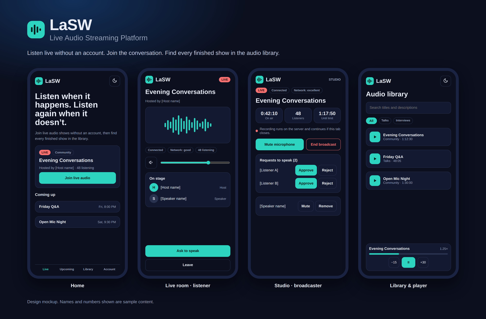
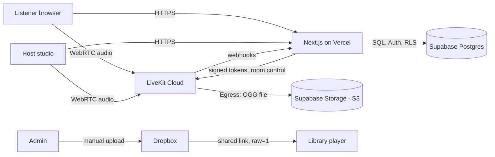

<div align="center">



# LaSW — Live Audio Streaming Platform

**Listen live without an account. Join the conversation. Find every finished show in the library.**

An open-source, audio-only live broadcasting and on-demand audio platform, designed to run on **free plans only** and to be set up entirely from a phone browser.


[Features](#-features) · [Tech stack](#-tech-stack) · [How it works](#-how-it-works) · [Deploy your own](#-deploy-your-own) · [Other hosts](#-deploying-somewhere-other-than-vercel) · [Free-tier limits](#-free-tier-reality-check) · [Roadmap](#-known-limitations-and-roadmap)

</div>

---

## 📖 Table of contents

1. [What is LaSW?](#-what-is-lasw)
2. [Features](#-features)
3. [Tech stack](#-tech-stack)
4. [How it works](#-how-it-works)
5. [Project structure](#-project-structure)
6. [Database](#-database)
7. [Deploy your own (fork → Vercel)](#-deploy-your-own)
8. [Deploying somewhere other than Vercel](#-deploying-somewhere-other-than-vercel)
9. [Environment variables](#-environment-variables)
10. [Customizing](#-customizing)
11. [Local development](#-local-development-optional)
12. [Free-tier reality check](#-free-tier-reality-check)
13. [Security](#-security)
14. [Known limitations and roadmap](#-known-limitations-and-roadmap)
15. [Documentation index](#-documentation-index)
16. [Contributing](#-contributing) · [License](#-license) · [Acknowledgements](#-acknowledgements)

---

## 🎙️ What is LaSW?

LaSW is a complete web platform for **live audio shows**:

- A **broadcaster** goes live from a browser. The show is **recorded automatically on the server**.
- **Anyone** can listen. No account is needed.
- Listeners can **ask to speak**; the host or a moderator approves them.
- When the show ends, an administrator **archives the recording** (manually, to Dropbox) and publishes it to a public **audio library** with search, categories, tags and a persistent player.

It was built with a strict **zero-budget** rule: every required service has a free plan, nothing needs a credit card, and the app is honest about what the free plans cannot do (see [Free-tier reality check](#-free-tier-reality-check)).

> **Status:** Phases 1–3 are implemented and the site deploys on Vercel. Live audio, recording and the archive workflow follow the provider documentation but **have not been load-tested**. The long-term goal of 200 concurrent listeners is a future target, **not** something the free plans provide.

---

## ✨ Features

### For listeners (no account needed)
- Join a live show in one tap, hear the host in real time
- Volume and mute, connection and network-quality indicators, automatic reconnect
- **Ask to speak** and cancel the request
- Browse live, upcoming and past shows
- Public audio library: search, categories, tags, featured, most played, related recordings, pagination
- Persistent mini and expanded **audio player**: seek, back 15 s / forward 30 s, speed, volume, resume where you left off, next/previous, lock-screen controls where the browser supports them

### For registered users
- Email sign-up with verification, login, password reset
- Bookmarks, playlists (create, rename, remove items, delete), listening history, **continue listening**, saved playback speed

### For broadcasters (studio)
- Create, schedule and edit broadcasts with categories, cover link and co-hosts
- **Live studio:** go live, microphone mute and device choice, on-air timer, listener count, network status, end broadcast
- **Moderation:** approve or reject speaker requests, make a listener a speaker, mute or remove a speaker, remove a listener
- Recording runs on the server, so it continues even if the host's browser tab closes

### For administrators
- Dashboard, user and role management, broadcast management (including force-end), categories
- **Recordings:** status refresh, real-format check (reads the OGG/Opus headers), authenticated download
- **Dropbox archive workflow:** link check, browser playback and seek test, verification, guarded deletion of temporary files, add to library
- Library editing (tags, featuring, publishing), audit log, **system status** page that labels every value as measured, estimate, setting or unavailable

### Roles

| Role | Can do |
|---|---|
| `guest` | Listen to public shows and published audio |
| `listener` | Default for every new account. Bookmarks, playlists, history |
| `moderator` | Approve/remove speakers on a live show |
| `broadcaster` | Create and run shows |
| `admin` | Manage users, shows, recordings, library |
| `super_admin` | Everything, including granting admin roles |

Roles are enforced **twice**: in server code and in the database (Row Level Security). Nobody can promote themselves.

---

## 🧰 Tech stack

| Layer | Technology | Used for |
|---|---|---|
| Framework | **Next.js 15** (App Router, server actions, route handlers) | Pages, API, server-side authorization |
| UI | **React 19**, **TypeScript** (strict), **Tailwind CSS 3**, **lucide-react** | Interface, icons, light/dark theme |
| Validation | **zod** | Server-side input validation |
| Database & auth | **Supabase** (PostgreSQL, Auth, Row Level Security) via `@supabase/supabase-js` and `@supabase/ssr` | Users, roles, shows, recordings, library |
| Live audio | **LiveKit Cloud** (WebRTC) and `livekit-client` | Real-time audio, room permissions |
| Recording | **LiveKit Egress** → S3-compatible storage | Server-side OGG (Opus) recording |
| Temporary storage | **Supabase Storage** (S3 API) via **AWS SDK v3** | Holds recordings until archived |
| Long-term archive | **Dropbox** (manual upload, shared link) | Permanent audio files |
| Hosting | **Vercel** (Hobby) | Website and API |
| Source & automation | **GitHub**, GitHub Actions | Code, one-time zip unpacker for phone-only workflows |
| Fonts | Bricolage Grotesque, Hanken Grotesk | Typography |

There are no paid services and no self-hosted servers. LiveKit tokens and webhook verification use Node's built-in `crypto`, so there is no LiveKit server SDK to keep in sync.

---

## 🔧 How it works



### Live show
1. A host opens **Studio → Live studio → Go live**. The server creates a LiveKit room and starts a server-side **audio-only recording**.
2. The host gets a short-lived token that allows publishing. Every listener gets a token that allows **listening only**, issued only if capacity allows.
3. A listener taps **Ask to speak**. The request carries a signed proof of identity. A host, admin or moderator approves it; the **server** then raises that participant's permission in the room.
4. The host ends the show (or the room closes). LiveKit finalizes the file and sends a webhook, and the recording appears under **Admin → Recordings**.

### Recording lifecycle
`recording → finalizing → ready` (or `failed` with a readable reason). Nothing relies on the host's browser. The admin can refresh a status manually if a webhook is missed.

### Archive workflow (administrator-controlled)
1. Download the temporary file and upload it to Dropbox yourself.
2. Paste the share link. The app converts it to a direct-playback form (`raw=1`).
3. **Automatic check:** fetches the first 2 KB and confirms a real OGG/Opus file, range-request support (needed for seeking) and a matching file size.
4. **Browser test:** the button unlocks only after your browser really played the file and played on after a seek.
5. Mark verified → create the library item → publish.
6. Optionally delete the temporary file. This is refused unless the archive is verified, and needs explicit confirmation.

### Capacity and quotas
Limits live in `src/config/quotas.ts` and can be overridden by environment variables. The app never configures more than the provider cap, shows a friendly "full" message, and its System Status page shows warnings.

---

## 🗂️ Project structure

```text
.
├── src/
│   ├── app/
│   │   ├── (public pages)        /, /broadcasts/*, /library/*, /about
│   │   ├── login, register, forgot-password, reset-password, auth/
│   │   ├── dashboard/            user dashboard, listening, playlists
│   │   ├── admin/                users, broadcasts, categories, recordings, library, status, settings, audit-logs
│   │   ├── studio/               broadcaster dashboard and live studio
│   │   └── api/
│   │       ├── live/             start, end, token, speaker, requests, moderate, status
│   │       ├── livekit/webhook   LiveKit webhook receiver
│   │       ├── library/play      play counting
│   │       └── admin/recordings  authenticated downloads
│   ├── components/               ui, forms, layout, live, player, library, studio, admin, theme
│   ├── lib/
│   │   ├── supabase/             browser, server, middleware and service-role clients
│   │   ├── auth/                 role helpers (requireRole)
│   │   ├── livekit/              token signing, room and egress API calls
│   │   ├── live/                 authorization and show lifecycle
│   │   ├── storage/              S3-compatible storage helpers
│   │   ├── archive/              Dropbox link normalization and probing
│   │   └── data/                 query helpers
│   └── config/                   branding and free-tier quotas
├── supabase/
│   ├── migrations/               0001 … 0004 (run in order)
│   └── bootstrap_super_admin.sql
├── docs/                         setup guides, checklists, architecture
└── .env.example
```

---

## 🗄️ Database

Four ordered SQL migrations in `supabase/migrations/`:

| File | Adds |
|---|---|
| `0001_foundation_schema.sql` | Tables (profiles, roles, broadcasts, hosts, recordings, audio library, playlists, bookmarks, history, settings, audit log…), triggers, signup → profile + listener role |
| `0002_rls_policies.sql` | Row Level Security on every table, non-recursive helper functions (`SECURITY DEFINER` with a fixed `search_path`), role-grant guard |
| `0003_phase2_live.sql` | Live-audio columns, Postgres-backed rate limiter, moderation helper |
| `0004_phase3_library_archive.sql` | Library and archive columns, indexes, play counter, tightened read policies |

See [`docs/DATABASE_SCHEMA.md`](docs/DATABASE_SCHEMA.md).

---

## 🚀 Deploy your own

You need: a GitHub account, a Supabase account, a Vercel account, and later a LiveKit account and a Dropbox account. **No credit card.** If any service asks for one, stop.

> **Which Vercel plan?** Vercel's free **Hobby** plan is for **personal, non-commercial use only**. If you add ads, payments, donations, or run this for a company or client, use a paid Vercel plan or another host.

### 1. Fork the repository
Click **Fork** at the top of this page (the repository must be public to be forked). On Vercel Hobby, the fork must live in your **personal** GitHub account.

*No terminal and can't fork?* Follow [`docs/ANDROID_GITHUB_GUIDE.md`](docs/ANDROID_GITHUB_GUIDE.md), which uses a small GitHub Action to unpack a zip file.

### 2. Create the database (Supabase)
1. Create a free project at [supabase.com](https://supabase.com).
2. Open **SQL Editor** and run the four files in `supabase/migrations/` **in order** (`0001` → `0004`), one at a time. Each must report *Success*.
3. From **Project Settings → API**, copy the **Project URL**, the **publishable (anon) key** and the **service-role key**. The service-role key is secret.

### 3. Deploy to Vercel
1. At [vercel.com](https://vercel.com) choose **Add New → Project** and import your fork.
2. Add the environment variables `NEXT_PUBLIC_SUPABASE_URL`, `NEXT_PUBLIC_SUPABASE_PUBLISHABLE_KEY` and `SUPABASE_SERVICE_ROLE_KEY` (mark the last one **Secret**), then **Deploy**.
3. When it finishes, copy your site address, add it as `NEXT_PUBLIC_SITE_URL` (no trailing slash) and **Redeploy**.

### 4. Allow logins to return to your site
In Supabase → **Authentication → URL Configuration** set the **Site URL** to your address and add `https://YOUR-SITE/auth/callback` to **Redirect URLs**. Keep **Confirm email** on.

### 5. Make yourself super admin
1. Register on your site and confirm the email. (Register **after** running the migrations.)
2. In the SQL Editor run `supabase/bootstrap_super_admin.sql` after replacing the email with yours. It must return one row.
3. Open `/admin`, then give yourself the `broadcaster` role under **Admin → Users**.

There is deliberately **no** public route that can create an administrator.

### 6. Live audio (LiveKit Cloud)
1. Create a project at [cloud.livekit.io](https://cloud.livekit.io). Create an API key.
2. Add to Vercel: `LIVEKIT_URL` (starts with `wss://`), `LIVEKIT_API_KEY`, `LIVEKIT_API_SECRET` (Secret).
3. In LiveKit **Settings → Webhooks**, add `https://YOUR-SITE/api/livekit/webhook`. Without it, use **Refresh status** on recordings.

### 7. Recording storage (no card needed)
1. Supabase → **Storage → New bucket** named `recordings`, **Private**.
2. Storage → **S3 configuration**: enable it, note the **Endpoint** and **Region**, and create an **access key**.
3. Add to Vercel: `R2_ENDPOINT`, `STORAGE_REGION`, `R2_ACCESS_KEY_ID`, `R2_SECRET_ACCESS_KEY`, `R2_BUCKET_NAME=recordings`. (The `R2_` prefix is historical; any S3-compatible service works.)
4. **Redeploy** so the new variables take effect.

### 8. Test
Run a short show with two phones and walk through [`docs/TESTING_CHECKLIST.md`](docs/TESTING_CHECKLIST.md). Then check **Admin → Status** for warnings.

Detailed, screenshot-friendly versions of these steps are in [`docs/`](#-documentation-index).

---

## 🌍 Deploying somewhere other than Vercel

LaSW uses server actions, route handlers, middleware and Node's `crypto`, so it needs a host that can run **Next.js server code** (a static export will not work). Vercel is the one tested here; the rest are **untested options** — treat them as starting points.

| Host | Notes |
|---|---|
| **Netlify** | Supports Next.js 15 through its OpenNext-based runtime. Set the same environment variables. |
| **Cloudflare (Workers/Pages)** | Possible with the OpenNext Cloudflare adapter and Node compatibility enabled. Check that `node:crypto` and the AWS SDK behave on your plan. |
| **Railway / Render / Fly.io** | Run as a normal Node service: build command `npm run build`, start command `npm start`, Node 20+. |
| **Your own server or Docker** | Same as above. For containers, enable `output: "standalone"` in `next.config.mjs` and build with the official Next.js Docker example. |

On any host:
- Set `NEXT_PUBLIC_SITE_URL` to your real address and update Supabase's redirect URLs.
- Point the LiveKit webhook to `https://YOUR-HOST/api/livekit/webhook`.
- The app needs outbound HTTPS to Supabase, LiveKit and Dropbox.
- Check that host's free-tier and commercial-use terms yourself.

---

## 🔐 Environment variables

Copy `.env.example` and fill in what you need. Phase 1 runs with only the Supabase values; optional services never block the rest of the app.

| Variable | Type | Needed for |
|---|---|---|
| `NEXT_PUBLIC_SUPABASE_URL` | Public | Everything |
| `NEXT_PUBLIC_SUPABASE_PUBLISHABLE_KEY` | Public | Everything |
| `NEXT_PUBLIC_SITE_URL` | Public | Auth emails, metadata |
| `NEXT_PUBLIC_APP_NAME` | Public, optional | Default site name (also editable in **Admin → Settings**) |
| `SUPABASE_SERVICE_ROLE_KEY` | **Secret** | Live audio, recordings, status page |
| `LIVEKIT_URL` | Config | Live audio (`wss://…`) |
| `LIVEKIT_API_KEY` | **Secret** | Live audio |
| `LIVEKIT_API_SECRET` | **Secret** | Live audio, webhook verification |
| `R2_ENDPOINT` | Config | Recording storage (any S3-compatible endpoint) |
| `STORAGE_REGION` | Config | Recording storage |
| `R2_BUCKET_NAME` | Config | Recording storage |
| `R2_ACCESS_KEY_ID` | **Secret** | Recording storage |
| `R2_SECRET_ACCESS_KEY` | **Secret** | Recording storage |
| `MAX_LISTENERS` | Optional | Default 90 (never exceeds the provider cap) |
| `MAX_SPEAKERS` | Optional | Default 5 |
| `MAX_BROADCASTERS` | Optional | Default 1 |
| `MAX_BROADCAST_DURATION_MIN` | Optional | Default 120 |

**Never** put a secret in a variable that starts with `NEXT_PUBLIC_`, and never commit real keys to GitHub.

---

## 🎨 Customizing

- **Name and branding:** set the name in **Admin → Settings → Platform name**, or `NEXT_PUBLIC_APP_NAME`. Logo: `src/components/layout/logo.tsx`.
- **Colors and theme:** design tokens are CSS variables in `src/app/globals.css` (light and dark), mapped in `tailwind.config.ts`.
- **Capacity:** `src/config/quotas.ts` and the optional environment variables above.
- **Moving to a bigger plan later:** raise the limits in config after upgrading your LiveKit plan. The architecture does not change.

---

## 💻 Local development (optional)

You do not need this to deploy, but it helps if you want to contribute.

```bash
git clone https://github.com/<your-username>/<your-fork>.git
cd <your-fork>
cp .env.example .env.local     # fill in the values
npm install
npm run dev                    # http://localhost:3000
```

Requires Node.js 20 or newer. Add `http://localhost:3000/auth/callback` to Supabase's redirect URLs for local logins.

---

## 💸 Free-tier reality check

Checked against provider documentation in October 2026. Provider limits change, so verify before relying on them.

| Service | Confirmed | Not confirmed / risk |
|---|---|---|
| **LiveKit Build** | 100 concurrent participants (hard cap, requests fail rather than bill); file egress limited to 3 hours | 5,000 connection minutes per month (third-party sources only). One 1-hour show with 100 listeners would use ~6,000 |
| **Vercel Hobby** | Personal, non-commercial use only | Usage caps change |
| **Supabase Free** | Postgres, Auth, RLS, S3-compatible Storage endpoint, 50 MB per file | Email rate limit, inactivity pausing, total storage |
| **Dropbox Free** | `raw=1` direct links work for playback | Shared-link bandwidth is capped per account per day (a commonly quoted 20 GB/day is second-hand). Dropbox is not a content host |
| **Cloudflare R2** | 10 GB free | A payment method is usually required, so it is not the default |

What follows from this:
- Default limits are **90 listeners, 5 speakers, 1 broadcaster, 120-minute shows** (about 43 MB per recording at 48 kbps, under the 50 MB file limit).
- The **200-listener target is a future goal**. It is not available on free plans and has **not** been tested.
- Never upgrade or add a card because of a warning in this app.

Full details: [`docs/FREE_TIER_LIMITATIONS.md`](docs/FREE_TIER_LIMITATIONS.md).

---

## 🛡️ Security

- Row Level Security on every table; helper functions use `SECURITY DEFINER` with a fixed `search_path` to avoid recursive policies
- Roles checked on the server for every protected page, action and API route
- Service-role and LiveKit secrets are used only in server-only modules; browsers receive short-lived join tokens only
- Speaker requests carry an HMAC proof of the issued identity; LiveKit webhooks are verified by signature and body hash
- Postgres-backed per-IP rate limiting on sensitive routes
- Redirect targets are sanitized; Dropbox links must be `https` and on `dropbox.com`
- Temporary recordings can be deleted only after the archive is verified and an admin confirms

This was **code-reviewed, not penetration-tested**, and has no automated tests or dependency audit yet. See [`docs/SECURITY_CHECKLIST.md`](docs/SECURITY_CHECKLIST.md). To report a vulnerability, open a private security advisory on GitHub rather than a public issue.

---

## 🧭 Known limitations and roadmap

**Limitations**
- Not load-tested; the 200-listener goal is unproven
- `typescript.ignoreBuildErrors` is currently **on** in `next.config.mjs` so type-only complaints do not block deployment. Turning it off and fixing what the compiler reports is the first cleanup task
- Broadcast length is enforced by the studio timer and at token requests, not by an always-on server timer (Vercel Hobby cron is limited)
- Rate limits are per IP, so users behind one shared network share a budget
- Cover images are links, not uploads; the persistent player is not shown while listening live
- No automated tests yet

**Ideas**
- Re-enable strict type checking and add tests
- Cover-image uploads and a mini-player for live audio
- An always-on server-side duration limit
- A true audio host in place of Dropbox when traffic grows
- Higher capacity once a paid LiveKit plan is acceptable

---

## 📚 Documentation index

| Document | Purpose |
|---|---|
| [`docs/ANDROID_GITHUB_GUIDE.md`](docs/ANDROID_GITHUB_GUIDE.md) | Put the code on GitHub without a terminal |
| [`docs/SUPABASE_SETUP.md`](docs/SUPABASE_SETUP.md) | Database and auth setup |
| [`docs/VERCEL_DEPLOYMENT.md`](docs/VERCEL_DEPLOYMENT.md) | Deploying to Vercel |
| [`docs/LIVEKIT_SETUP.md`](docs/LIVEKIT_SETUP.md) | Live audio setup |
| [`docs/RECORDING_SETUP.md`](docs/RECORDING_SETUP.md) | Recording storage setup |
| [`docs/DROPBOX_ARCHIVE_GUIDE.md`](docs/DROPBOX_ARCHIVE_GUIDE.md) | Archiving recordings |
| [`docs/FINAL_DEPLOYMENT_GUIDE.md`](docs/FINAL_DEPLOYMENT_GUIDE.md) | Order of steps and ongoing care |
| [`docs/ARCHITECTURE.md`](docs/ARCHITECTURE.md) · [`docs/DATABASE_SCHEMA.md`](docs/DATABASE_SCHEMA.md) | How it is put together |
| [`docs/FREE_TIER_LIMITATIONS.md`](docs/FREE_TIER_LIMITATIONS.md) | What the free plans can and cannot do |
| [`docs/SECURITY_CHECKLIST.md`](docs/SECURITY_CHECKLIST.md) · [`docs/TESTING_CHECKLIST.md`](docs/TESTING_CHECKLIST.md) | Review and testing lists |
| [`docs/CHANGELOG.md`](docs/CHANGELOG.md) | What changed |

---

## 🤝 Contributing

Contributions are welcome.

1. Fork the repository and create a branch
2. Keep changes focused; follow the existing structure (server code under `src/lib`, UI under `src/components`)
3. Never commit secrets; update `.env.example` and the docs when you add a variable
4. Open a pull request describing what changed and how you tested it

Bug reports are most useful with the exact error text and the step where it happened.

## 📄 License

Released under the **GNU General Public License v3.0**. See [`LICENSE`](LICENSE).

## 🙏 Acknowledgements

[Next.js](https://nextjs.org) · [React](https://react.dev) · [Tailwind CSS](https://tailwindcss.com) · [Supabase](https://supabase.com) · [LiveKit](https://livekit.io) · [Vercel](https://vercel.com) · [Dropbox](https://www.dropbox.com) · [lucide](https://lucide.dev) · [zod](https://zod.dev)

<div align="center">

**LaSW — Live Audio Streaming Platform**

</div>
